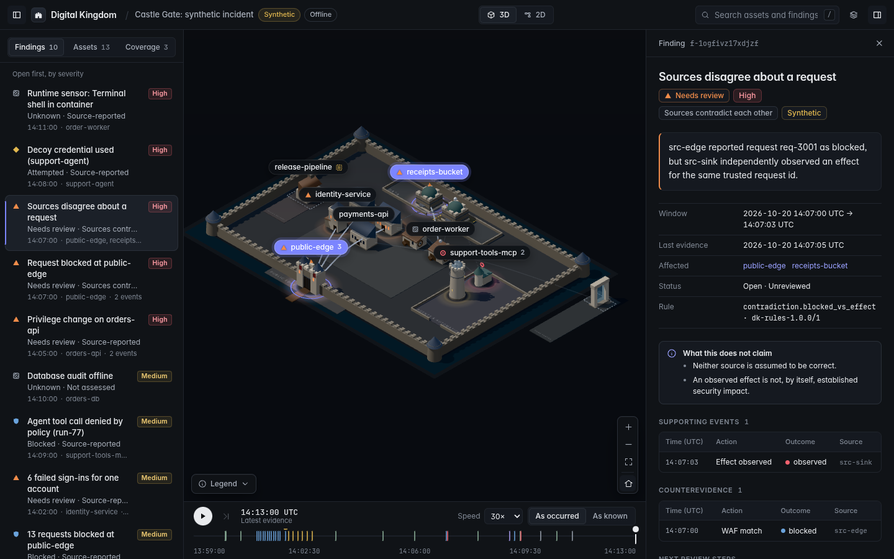
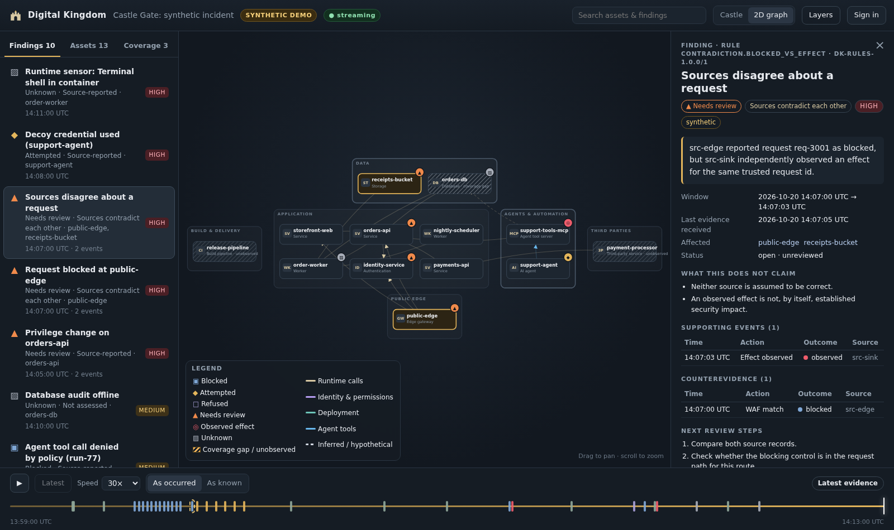
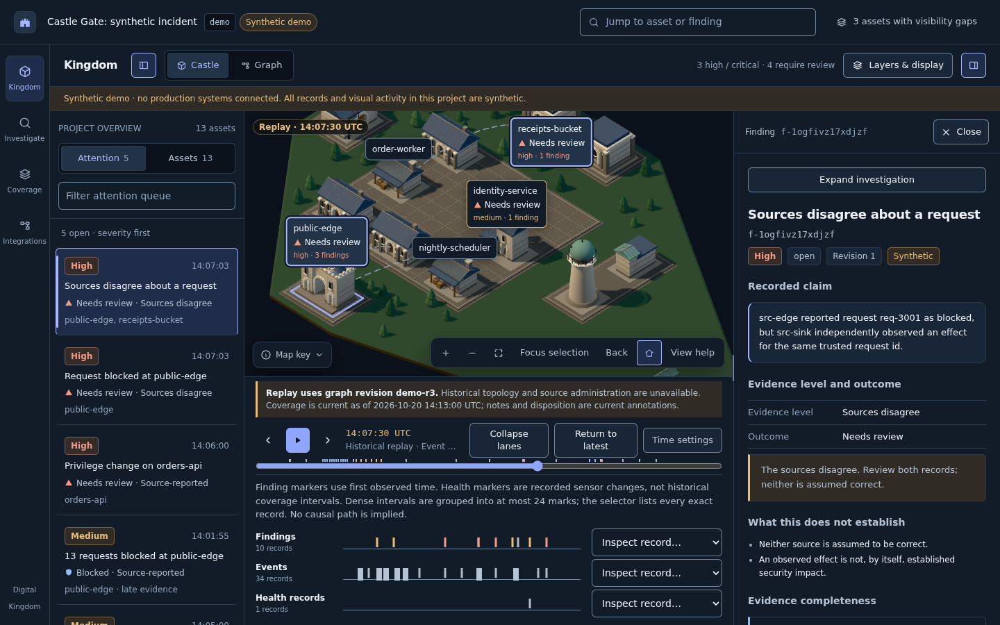

# Digital Kingdom

**A self-hosted security evidence console for small software teams, rendered as a navigable castle, and an MCP layer so AI agents can see the same evidence.**

Every service, database, worker, AI agent and tool server becomes a room in an isometric castle. Blocked probes, failed sign-ins, privilege changes, decoy-credential use, agent tool calls, observed side effects and lost telemetry show up on the right room, on a matching 2D graph, on a replayable timeline, and in an evidence pane that says exactly what is known, what is not, and what is *not* being claimed.

The castle is the human interface. **[Digital Kingdom MCP](#digital-kingdom-mcp-the-agent-interface)** is the agent interface. Both read one security engine.



| 2D graph (same evidence, same selection) | Historical replay ("as occurred" vs "as known") |
|---|---|
|  |  |

> **Status: v0.3.1, trustworthiness release plus hardening.** See [CHANGELOG.md](CHANGELOG.md).
>
> **Scope:** It ingests, stores, correlates, renders and replays real events from local sources and adapters, with a full synthetic demo. It is **not** a SIEM, an EDR, a WAF, a compliance product, or an autonomous responder, and it does not execute remediation. See [Known limitations](#known-limitations).

---

## Quick start

Requirements: Node 22.13+ and pnpm 10.

```bash
pnpm install
pnpm --filter @dk/web build      # build the UI once
pnpm start                       # API + worker + UI on http://127.0.0.1:8787
```

On first start the server prints a **bootstrap admin token once**, seeds the isolated **synthetic** project `demo-castle`, and enables *demo mode* (anonymous read-only access to synthetic projects only). Open http://127.0.0.1:8787.

Other ways to run it:

| Goal | Command |
|---|---|
| Offline demo, no server at all (same engine in the browser) | `pnpm --filter @dk/web dev`, then open http://localhost:5173 with no server running |
| UI dev with hot reload against the API | `pnpm dev:server` and `pnpm dev:web` |
| Docker (localhost-bound, non-root, read-only rootfs) | `docker compose -f infra/compose/docker-compose.yml up --build` |
| Everything CI runs | `pnpm check && pnpm build` |

Keyboard: `/` search, `2` 2D graph, `3` castle, `Space` play or pause replay, `←/→` scrub on the timeline (Shift = 1 minute), `R` roofs, `0` reset camera, `Esc` clear selection.

## What you're looking at

| Castle element | System meaning |
|---|---|
| Gatehouse (in the curtain wall) | Edge gateway, reverse proxy, WAF |
| Guardhouse | Authentication / identity |
| Hall / Great hall | Logical application service (replicas are grouped, never one room per pod) |
| Workshop | Worker, queue consumer, scheduler |
| Vault | Database or storage |
| Observatory | AI agent runtime |
| Tool annex | Agent tool / MCP server |
| Forge | Build and deployment pipeline |
| Portal (across the moat) | Third-party service; its interior is never shown |
| Hatched ground with **?** | Coverage gap: missing telemetry is **unknown, never safe** |
| Dashed path | Inferred or hypothetical relationship, not observed |

Every status is a **shape + word + color**, never color alone: ▣ Blocked, ◆ Attempted, ▲ Needs review, ◎ Observed effect, □ Refused (model declined, which is not enforcement), ▨ Unknown.

## Architecture

```
sources (WAF, app SDK, identity, DB audit, Falco, OTLP, decoys, agent wrapper, effect observer)
   │  source keys bound to one project (payload can never choose the project)
   ▼
receive ─▶ durable journal (SQLite WAL, sync=FULL; ack only after commit; duplicates counted)
   ▼
normalize (schema, alias→stable asset id, redaction, route templates, request-id trust)
   ▼
events ─▶ deterministic rules ─▶ findings (+ revisions) ─▶ outbox ─▶ resumable SSE
                                    │
            graph ─▶ scene compiler (validated proposal, pinned slots, digest)
                                    │
     ┌──────────────────────────────┼─────────────────────────────┐
  castle (R3F)                2D graph (SVG)                MCP server (agents)
```

| Package | Role |
|---|---|
| `packages/contracts` | JSON Schemas (v0.2, v0.1-compatible), TypeScript types, **precompiled** validators (no runtime `eval`, so the UI runs under a strict CSP), module catalog |
| `packages/graph-core` | Graph validation, alias resolution, bounded traversal, temporal topology (`graphAsOf`), diffing, Compose and manifest importers (allowlisted keys only; never executes repo code or reads env values) |
| `packages/scene-compiler` | Proposal validation, deterministic layout with pinned slots and per-zone capacity (adding a service never moves other rooms; overflow is reported as a reflow), optional AI planner with bounded retries and guaranteed fallback |
| `packages/detections` | Redaction, normalization, rules (blocked requests, repeated auth failure, privilege change, decoy use, source contradiction, agent denial and effect, runtime alert, coverage loss), replay (`stateAt`), in-memory pipeline |
| `packages/sdk-node` | App adapter: unsampled security events, keyed-hash session pseudonyms, bounded queue, retries, counted drops |
| `apps/server` | Fastify API, source and user auth, durable journal, worker, findings and revisions, SSE, Falco and OTLP adapters, case export and verification, containment proposals, agent-context API |
| `apps/web` | React + Three.js castle, 2D graph, timeline, evidence pane; offline demo mode |
| `apps/mcp` | Digital Kingdom MCP server |
| `examples/reference-app` | Isolated local app used for live end-to-end verification |

The same engine code runs on the server, in the offline browser demo, in the MCP-backed API, and in tests.

## Digital Kingdom MCP: the agent interface

Any MCP-capable agent working on your application can understand the security situation: which services exist, which threats have been observed, which defenses are active, where telemetry is missing, and which containment steps are permitted.

```jsonc
// e.g. Claude Desktop / Cursor / any MCP client
{
  "mcpServers": {
    "digital-kingdom": {
      "command": "npx",
      "args": ["tsx", "/path/to/Digital-Kingdom/apps/mcp/src/main.ts"],
      "env": { "DK_URL": "http://127.0.0.1:8787", "DK_TOKEN": "<viewer or analyst token>", "DK_PROJECT": "demo-castle" }
    }
  }
}
```

| Tool | What the agent gets |
|---|---|
| `dk_assess_change` | Before editing code: a posture for the assets or routes it will touch, with `targets_requested / resolved / unresolved`. Postures: `hold`, `proceed_with_care`, `insufficient_context` (some targets unknown), `not_assessed` (nothing resolved; explicitly **not** a clean result), and `no_recorded_concerns` (every target resolved, nothing recorded; still not proof of safety) |
| `dk_security_context` | Everything about one service or HTTP route (`/admin/roles`): relationships, direct and adjacent findings, coverage, permitted containment, guidance |
| `dk_overview`, `dk_list_findings`, `dk_get_finding` | Findings with outcome state, evidence level and what each does **not** claim. `dk_get_finding` fetches events by the finding's own references (paginated, no recency window) and returns a `completeness` block with expected and returned counts, missing references, truncation and retrieval errors |
| `dk_coverage` | Which sources report, which are stale or offline, which assets have no telemetry at all |
| `dk_containment_options`, `dk_propose_containment` | Permitted containment steps. An analyst-role agent may **propose** one. It stays `pending` until a *different, human-typed* token decides it. Service tokens can request but never decide, and Digital Kingdom never executes anything |

Example: a coding agent updating the login handler calls `dk_assess_change({asset_ids:["identity-service"]})`, learns there are repeated sign-in failures followed by a success for the same account, and is told not to weaken rate limiting in this change. Meanwhile the guardhouse in the castle shows the same ▲.

Guardrails: evidence is returned inside an explicit *untrusted data* envelope (prompt-injection-aware), tokens are role-scoped server-side, and there is no tool that changes monitored systems. Give agents a **service** token (`POST /api/tokens` with `"principal_type":"service"`). Token delegation never escalates: only human admin tokens can issue tokens, requested projects must be within the issuer's scope (omitted means the issuer's scope, never all projects), only an installation admin (projects `*`) can issue `*` tokens or create projects, and project admins see only their projects' audit entries. Approval checks prove that a different human-typed token decided, **not** that two different people did; bind tokens to an identity provider before any executor is ever added.

The MCP layer is query-driven: an agent can ask what is happening. It does not subscribe to incidents or respond autonomously, by design at this stage.

## Sending real events

```bash
ADMIN=<bootstrap admin token>
curl -s -XPOST localhost:8787/api/projects -H "authorization: Bearer $ADMIN" -H 'content-type: application/json' \
  -d '{"id":"shop","name":"Shop","dataset_kind":"live"}'
curl -s -XPOST 'localhost:8787/api/projects/shop/graph?format=compose&revision=r1' -H "authorization: Bearer $ADMIN" \
  -H 'content-type: application/yaml' --data-binary @docker-compose.yml
curl -s -XPOST localhost:8787/api/projects/shop/sources -H "authorization: Bearer $ADMIN" -H 'content-type: application/json' \
  -d '{"id":"waf","label":"Edge WAF","kind":"waf","asset_ids":["proxy"],"trusts_request_ids":true}'   # returns a source key once
```

Then send events to `POST /ingest/events` (single or `{"events":[...]}`, max 500), Falco alerts to `POST /ingest/falco`, or OTLP traces to `POST /v1/traces`, each with `Authorization: Bearer <source key>`. For Node apps use `@dk/sdk-node`. Label Compose services with `dk.kind`, `dk.id`, `dk.owner` to make inventory explicit.

**Source capabilities.** Each source is assigned assets (required) and a kind that sets which event categories it may assert: `waf`, `app_security`, `app_auth`, `db_audit`, `honeytoken`, `agent_observer`, `effect_observer`, `falco`, `otel`, `generic`. Admins can override with `allowed_actions`. Observation categories (`side_effect_observed`, `decoy_used`) are never granted by default. Assertions outside a source's scope are rejected and counted (`asset_not_permitted`, `action_not_permitted`). Sources that relay the same underlying observer (two collectors, a log shipper) should share an `independence_group`; corroboration and contradiction rules compare groups, not source ids.

**OTLP/HTTP.** Supported: JSON encoding (`application/json`), optionally gzip (decompressed size capped at 16 MB). Protobuf is not supported (415). Success is HTTP 200 with an empty `ExportTraceServiceResponse`; partial rejection is HTTP 200 with `partialSuccess.rejectedSpans`; errors are `google.rpc.Status`-shaped JSON. Retries are idempotent (keyed by trace and span id). Spans without `http.route`, `url.path` or `dk.security` are accepted but not stored. Tested with the official `@opentelemetry/exporter-trace-otlp-http` exporter, uncompressed and gzip; an OpenTelemetry Collector binary has not been run against it yet.

## Security model (short)

- **Read-only toward production.** No credentials for monitored systems, no remediation, no exploit execution. Containment is a human-approved proposal.
- **Backend authorization** for every route. Roles: viewer, analyst, admin. Cookie sessions are HttpOnly + SameSite=Strict with a required `X-DK-Request` header on writes.
- **Source keys** are hashed at rest, bound to one project and dataset kind. Synthetic and live data can never mix.
- **Ingestion hardening:** body limits, no compressed bodies, depth and node limits, prototype-pollution rejection, schema validation, bounded batches.
- **Redaction before persistence:** every inbound record is schema-validated and minimized *before the first durable write*. Credential-bearing keys are removed, bearer tokens, JWTs, key-shaped strings and card-like numbers are masked in every free-text field, and query strings are dropped. Only that minimized envelope is journaled; raw originals are never written (`PRAGMA secure_delete=ON`). Tested by scanning the SQLite files for planted markers before processing, after processing and after restart. Free text with no recognizable secret pattern cannot be detected, so don't send secrets as plain prose.
- **Source capabilities:** producers can only assert events about their assigned assets and permitted categories.
- **Server-controlled metadata:** field names starting with `_dk_` are reserved and rejected at ingestion; redaction metadata lives in a separate journal column and is type-checked on every replay.
- **Poison-record isolation:** a record that fails processing deterministically is quarantined (`GET /api/projects/:p/quarantine`), counted and audited, and the queue moves on. Database and I/O failures are retried with the checkpoint held, never quarantined.
- **Upgrading from v0.2:** v0.2 journaled raw payloads. On first start, v0.3.1 re-minimizes every legacy journal row in place, then checkpoints and truncates the WAL. See [docs/UPGRADING.md](docs/UPGRADING.md) for what that cannot reach (backups, snapshots).
- **AI is optional and presentation-only.** The planner sees ids, kinds and short names only, and its output is untrusted until it passes schema and semantic validation. No AI is needed to run anything.
- **Exports** carry per-section SHA-256 digests and an HMAC signature: tamper detection relative to this server, explicitly *not* proof of completeness or admissibility.

Details: [SECURITY.md](SECURITY.md) and [docs/THREAT_MODEL.md](docs/THREAT_MODEL.md).

## Verification

`pnpm check` runs typecheck, **138 tests**, and fixture validation. Highlights, mapped to the blueprint's acceptance suite ([docs/VERIFICATION.md](docs/VERIFICATION.md)):

- Evidence E01–E12: dedupe, distinct ids, no IP-only linking, untrusted request ids, blocked ≠ compromise, HTTP 200 ≠ exploit, coverage gaps, contradiction with counterevidence, late-event revision, decoy semantics, temporal topology.
- Durability O01/O02/O06: restart without loss, crash mid-batch rolls back and recovers idempotently, SSE resume and resync.
- Security S01–S14 (implemented subset): auth, roles, project binding, hostile labels, size and depth limits, redaction, AI proposal rejection, planner fallback, export tamper detection, demo isolation.
- Visual V01–V03, V06, V12: deterministic compile, stable rooms on graph change, replicas grouped, WebGL loss → 2D, stable ids.
- Live local end-to-end: real benign actions against the reference app → SDK → ingestion → findings in the right room, with forged public request ids ignored and passwords never stored.
- MCP: an MCP client drives the real server and gets the same findings as the castle; viewer agents cannot propose containment.
- Trustworthiness (v0.3): planted secrets never reach disk; unknown, missing-graph, mixed and failed lookups never get a favorable posture; out-of-scope source assertions are rejected; relayed reports don't corroborate themselves; a finding's evidence survives 5,100 later events, more than 50 records, truncation and a deleted record, with incompleteness explicit in MCP, UI and exports; OTLP success, gzip, partial success, empty, invalid, wrong-encoding, gzip-bomb and retry cases.

The UI was exercised in headless Chromium (SwiftShader WebGL); screenshots above are from that run.

## Known limitations

- Single node: SQLite (WAL, `synchronous=FULL`) stands in for PostgreSQL; the store is one class with a PostgreSQL-shaped schema. No HA, no multi-tenant SaaS.
- Rules are a deliberately small, explainable set. No ML, no attribution, no exploit verification.
- Adapters: generic events, Node SDK, Falco HTTP output, OTLP/HTTP JSON (sampled context only; no protobuf; not yet run against a Collector binary). No cloud-audit, Cloudflare, or Postgres pgAudit adapters yet.
- Snapshot views load the latest 5,000 events; older findings fetch their own evidence on demand and say when a view is incomplete.
- Containment decisions prove distinct human-typed tokens, not distinct people.
- Castle art is an original procedural kit (Apache-2.0). It is readable, not bespoke artwork; LOD, instancing beyond merged parapets, and per-device performance budgets are not yet measured on real hardware.
- Accessibility: keyboard paths, focusable 2D graph, text equivalents and reduced motion are implemented; a screen-reader audit and contrast review on real assistive tech have not been done.
- Not a compliance product. Do not expose the demo publicly with live data.

## License

Apache-2.0. See [LICENSE](LICENSE). The original blueprint lives in [docs/blueprint](docs/blueprint).
